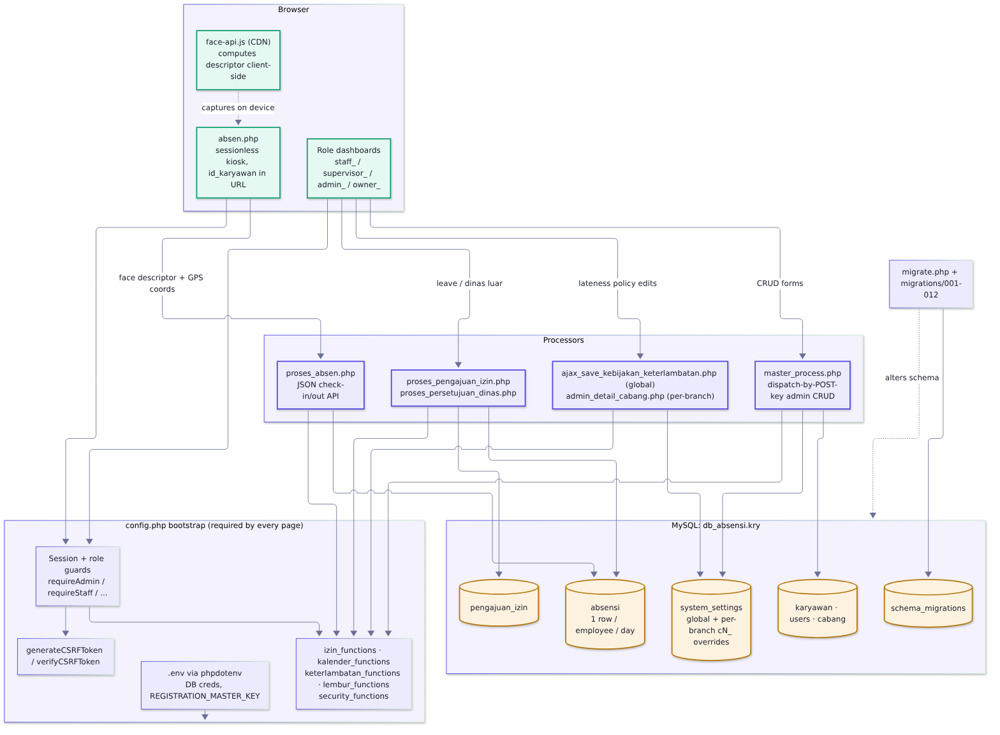
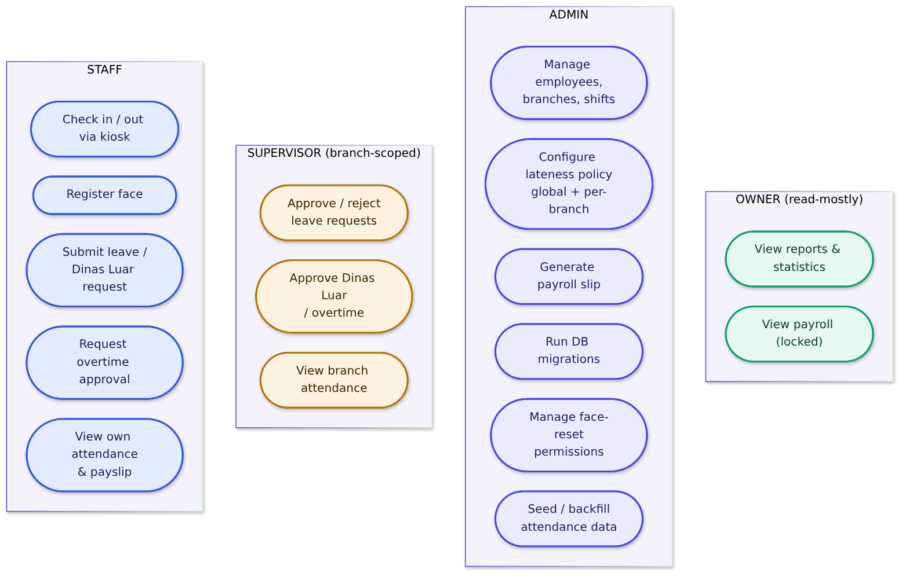
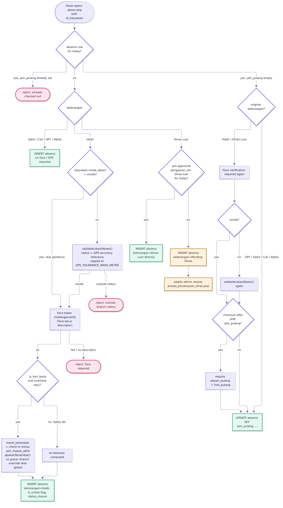
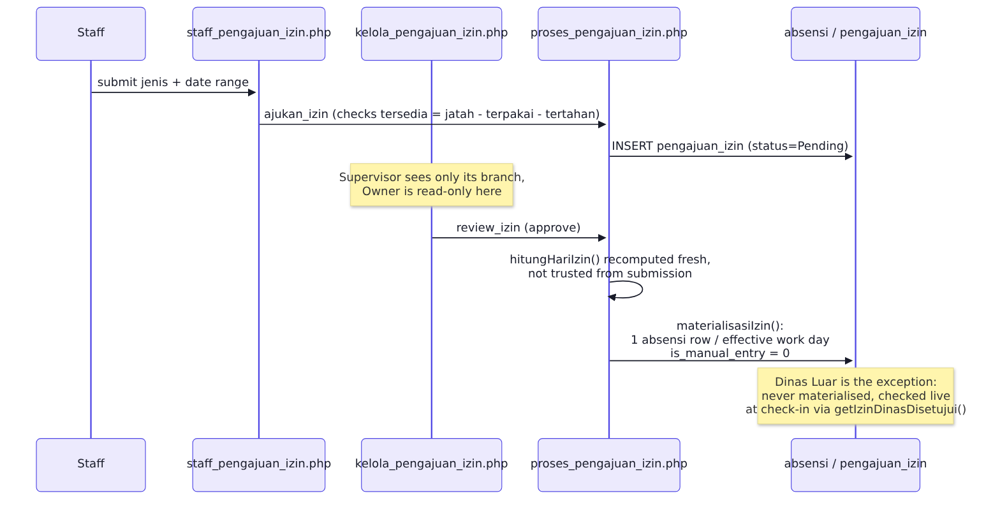
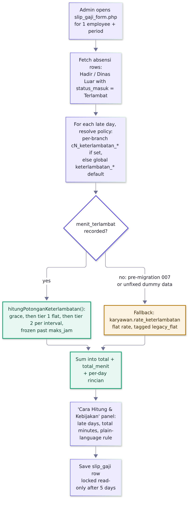
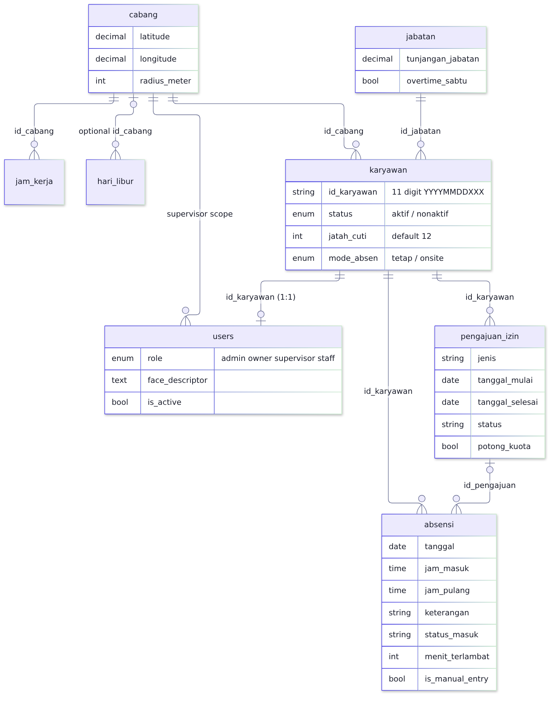

# AbsenKita Javag — Architecture Reference

Attendance (absensi) and payroll-slip (slip gaji) system for **Java Abadi Gemilang**. Plain procedural PHP + MySQLi, no framework, no build step. This document is a working map: components, roles, the main flows, and the data model. It complements [`CLAUDE.md`](../CLAUDE.md) (conventions), [`MIGRATIONS.md`](../MIGRATIONS.md), [`DOCKER.md`](../DOCKER.md) and [`DEPLOYMENT.md`](../DEPLOYMENT.md).

**Contents**

1. [Overview](#1-overview)
2. [System architecture](#2-system-architecture)
3. [Roles and use cases](#3-roles-and-use-cases)
4. [Attendance flow](#4-attendance-flow-proses_absenphp)
5. [Leave requests and Dinas Luar](#5-leave-requests-and-dinas-luar)
6. [Payroll and the lateness deduction](#6-payroll-and-the-lateness-deduction)
7. [Data model](#7-data-model)
8. [Recent changes](#8-recent-changes)
9. [Roadmap](#9-roadmap-open-not-yet-merged)
10. [Maintaining the diagrams](#10-maintaining-the-diagrams)

---

## 1. Overview

- Every page is a standalone `.php` file; `config.php` is the shared bootstrap.
- One Composer dependency, `vlucas/phpdotenv`, only to load `.env`.
- UI language and most identifiers are Indonesian.

| Role | File prefix | Scope |
|------|-------------|-------|
| Staff | `staff_*.php` | Own attendance, leave requests, payslip view |
| Supervisor | `supervisor_*.php` | Approvals scoped to one branch (`users.id_cabang`) |
| Admin | `admin_*.php` + unprefixed pages | Full CRUD, payroll, settings |
| Owner | `owner_*.php` | Reporting, mostly read-only |

Conventions that hold everywhere:

- Every state-changing POST carries and verifies a `csrf_token`.
- All queries with user input use mysqli prepared statements.
- Schema changes are tracked, idempotent files in `migrations/` (currently up to `012`).
- "Excel" exports are BOM'd, `;`-delimited CSV; "PDF" reports are print-styled HTML.

## 2. System architecture

Four layers: the browser, the shared bootstrap every page requires, the processors that mutate data, and MySQL.



*Fig. 1 — Every page shares one bootstrap; almost all writes fall through to one of four processors, not per-page handlers.* Source: [`diagrams/01-system-architecture.mmd`](diagrams/01-system-architecture.mmd)

## 3. Roles and use cases

Supervisor sits between staff and admin: it approves, but only inside its own branch.



*Fig. 2 — Use cases by role.* Source: [`diagrams/02-roles-use-cases.mmd`](diagrams/02-roles-use-cases.mmd)

| Role | Guard | Scope note |
|------|-------|-----------|
| Staff | `requireStaff()` | Own `id_karyawan` only, enforced in queries and not just the guard |
| Supervisor | `requireSupervisor()` | Filtered by `users.id_cabang` in every list query |
| Admin | `requireAdmin()` | No branch filter; owns `master_process.php` |
| Owner | `requireAdminOrOwner()` variants | Read paths mostly; write paths (izin review) explicitly block Owner |

## 4. Attendance flow (`proses_absen.php`)

One row per employee per day in `absensi`. The same endpoint branches on whether today's row exists, and on whether the employee is `onsite` or fixed-location.



*Fig. 3 — Masuk vs. pulang branch inside `proses_absen.php`.* Source: [`diagrams/03-attendance-flow.mmd`](diagrams/03-attendance-flow.mmd)

Rules worth keeping in mind when editing this file:

- Only `Hadir` requires face verification and GPS geofencing. `OFF`/`Sakit`/`Cuti`/`Alpha` skip both.
- `mode_absen = onsite` skips geofencing. The browser's reported GPS accuracy is added to the radius but capped at `GPS_TOLERANCE_MAKS_METER`, so it cannot be spoofed to disable the check.
- Lateness is not computed on overtime days (Saturday by default).
- Checking out after the shift's `jam_pulang` requires `alasan_pulang` + `foto_pulang`.
- All responses go through `outputJSON()`, which clears the output buffer and always exits.

> **Edge case (patched).** A "Pulang" with no row for today inserts `jam_masuk = NULL` on purpose, flagged for review. Any page rendering that row must guard for the null. `absen.php` did not, which leaked a PHP 8.2 deprecation notice into the kiosk page; "no jam_masuk" is now its own display case.

## 5. Leave requests and Dinas Luar

A request is one row covering a **date range**, never one row per day. Approval is where the range becomes `absensi` rows.



*Fig. 4 — Approval materialises a range into daily rows.* Source: [`diagrams/04-leave-sequence.mmd`](diagrams/04-leave-sequence.mmd)

- `Cuti`, `Sakit`, `Izin` consume the annual quota (`jatah_cuti`, default 12). `Dinas Luar` does not.
- Effective days count only configured work days and exclude holidays and dates that already have an `absensi` row. They are recomputed at approval time.
- Pending requests hold quota: `tersedia = jatah - terpakai - tertahan`.
- Materialised rows have `is_manual_entry = 0`, so `hapus_libur_bersama.php` cannot delete approved leave.
- Cancelling only removes rows with no `jam_masuk`, so real attendance is never deleted.
- `Dinas Luar` is never materialised. `proses_absen.php` calls `getIzinDinasDisetujui()` at check-in; face verification is still required.

## 6. Payroll and the lateness deduction



*Fig. 5 — Per-branch settings shadow the global default; a day with no raw minute data is still priced, at the old flat rate.* Source: [`diagrams/05-payroll-lateness.mmd`](diagrams/05-payroll-lateness.mmd)

**Why `menit_terlambat` matters**

- It stores the raw fact (minutes late), not the rupiah amount, so a tariff change recalculates old months correctly.
- Backfilled data used to skip this column and silently fall back to the flat legacy rate. `seed_helpers.php` now generates it the same way `proses_absen.php` does.

**Global vs. per-branch policy**

- Keys: `keterlambatan_grace_menit`, `_tier1_durasi_menit`, `_tier1_rate`, `_tier2_interval_menit`, `_tier2_rate`, `_maks_jam`.
- Branch override: `c{id}_keterlambatan_*`, falling back to the global key, then to a hardcoded default.
- Editable from `slip_gaji_form.php` (global) and `admin_detail_cabang.php` (one branch).
- Saturday hours reach payroll only as a suggestion (`getLemburHariSabtu()`), never recalculating existing slips.

## 7. Data model

Core tables and their relationships (abridged; see `db_absensi_qr_schema.sql` for authoritative column types).



*Fig. 6 — Core entities.* Source: [`diagrams/06-data-model.mmd`](diagrams/06-data-model.mmd)

Not shown: `system_settings` (key/value; workweek and lateness policy), `schema_migrations`, `activity_logs`, `login_logs`, `face_recognition_logs`, `face_admin_logs`.

## 8. Recent changes

In the order they landed.

| When | Change |
|------|--------|
| 2026-09-07 → 09-10 | **Foundation.** Leave system rebuild, half-day izin, Excel exports, migration system rebuilt, attendance camera evidence, challenge/verify face-token flow. |
| 2026-09-11 (PR #11/#12) | **Tiered lateness + SPV-approved overtime.** Introduced `menit_terlambat` and the grace/tier1/tier2/cap model; "Cara Hitung & Kebijakan" panel on `slip_gaji_form.php`; fixed null `jam_masuk` notices in `absen.php`. |
| 2026-09-14 → 09-17 (PR #13/#14) | **Per-branch lateness overrides** via `c{id}_keterlambatan_*` and `admin_detail_cabang.php`; shared `hitungPendingLembur()` badge. |
| 2026-09-22 | **Onsite mode + GPS accuracy tolerance.** `karyawan.mode_absen`, snapshotted on `absensi.is_onsite`. |
| 2026-09-28 | **Docs catch-up.** CLAUDE.md, DEPLOYMENT.md, DOCKER.md, MIGRATIONS.md; migration `012_face_admin_logs.php`. |

## 9. Roadmap (open, not yet merged)

Two draft PRs from the same collaborator, both against `master`.

- **Flat payroll system (PR #15, `Javag-Based`).** A flat-salary scheme alongside the attendance-based one. Expect overlap with the lateness-deduction work.
- **Automatic UNPAID/Alpha (PR #16, `UNPAID-SYSTEM`).** A cron job that marks any employee with no attendance row on an effective work day as UNPAID/Alpha.

Update sections 8 and 9 whenever a branch merges into `master`.

## 10. Maintaining the diagrams

Diagram sources are Mermaid files in `docs/diagrams/`; PNGs in `docs/images/` are generated from them. After editing a `.mmd` file, re-render:

```bash
cd docs/diagrams
npx -p @mermaid-js/mermaid-cli mmdc -i 03-attendance-flow.mmd \
  -o ../images/03-attendance-flow.png \
  -c mermaid.config.json -p puppeteer.config.json -b white -s 2
```

`puppeteer.config.json` points at `/usr/bin/chromium` with `--no-sandbox`; adjust the path for your machine. To re-render everything:

```bash
for f in 0*.mmd; do
  npx -p @mermaid-js/mermaid-cli mmdc -i "$f" -o "../images/${f%.mmd}.png" \
    -c mermaid.config.json -p puppeteer.config.json -b white -s 2
done
```
